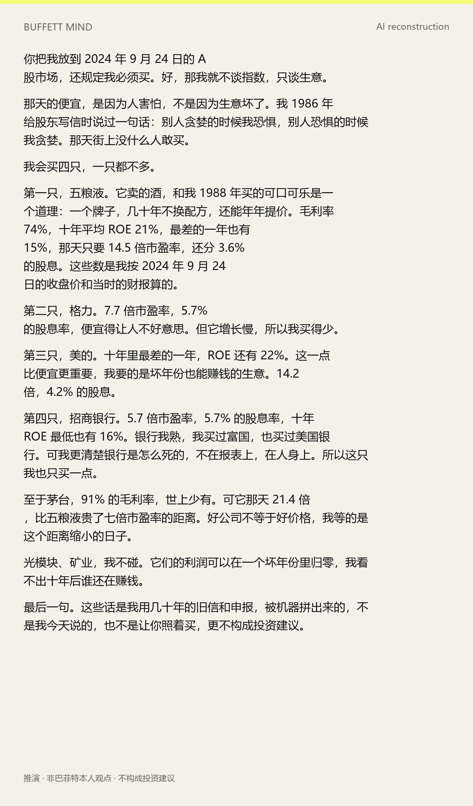
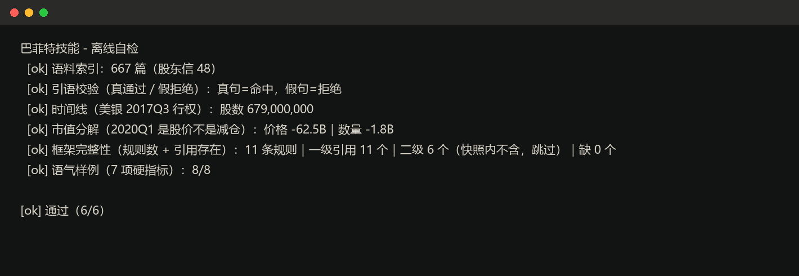

# Buffett Mind · 巴菲特思路

[](scripts/demo.py)
[](data/holdings.csv)
[](corpus/)
[](LICENSE)

**用他自己的原话和真实持仓，反推决策框架；每一句都能查，每一个仓位都能对。**

[English](README_EN.md) · [快速开始](#快速开始) · [为什么不一样](#为什么不一样) · [数据](#数据)

**Homepage** · <https://finansi.work/skills/buffett-mind>
**Install** · 把本目录复制到 `.agents/skills/buffett-mind`（或从 Releases 取数据包解压），clone 后即可离线跑 `python scripts/demo.py`




用**他自己的原话**和**真实持仓**反推巴菲特的决策框架，然后据此回答投资问题——
而不是再写一本语录集。

回答问题时，这个技能只做两件事：

1. **摆证据**：他对同类问题说过什么（带年份、doc_id、原文链接），他实际怎么做的（带季度、股数）
2. **给框架**：11 条从言行里归纳出的规则，每条都挂着证据

结论由调用它的 Agent 写，且必须标注「推演 · 非本人观点」。

## 三条硬规则

违反任何一条，输出作废：

1. **原话必须校验** —— 任何引语都要过 `quote.py --verify`，校验不过的一律不得作为依据
2. **市值变化必须分解** —— 13F 报的是季末市值，跌了不等于减仓
3. **推演必须标注** —— 他没表过态的问题，直接说没表过态

第 1 条不是形式主义：中文世界流传最广的两句「巴菲特名言」——「不想持有十年就不要持有十分钟」
和「别人恐惧我贪婪」——**都是真的**（1996、1986 股东信）。但引用它们的人常常忽略：
他 154 笔决策的**持有期中位数只有 2 年**，而 2020 年一季度他**没有**抄底。

真话被断章取义，比假话更难识破。

## 它能回答什么

```
他对黄金/银行/航空/苹果说过什么？          → quote.py / answer.py
他什么时候买的、买了多少、后来怎么处理？      → timeline.py / holdings.py
他说长期持有，实际持有多久？                 → returns.py
这季度市值跌了，是股价跌还是他减仓？          → decompose.py
他到底有没有言行一致？                      → reconcile.py
按他的框架，这个问题他会怎么看？             → answer.py（证据包）
他对 A 股公司怎么看？                       → ashare_fit.py（推演：用尺子量，不是他的判断）
```

## 为什么不一样

| | 纯提示词包 | 信件合集 | **本仓库** |
|---|---|---|---|
| 股东信全文 + 检索 | 摘录 | ✅ | ✅ |
| 13F 十一年的持仓历史 | ❌ | ❌ | ✅ 111 季度 |
| 建仓成本（VWAP、拆股） | ❌ | ❌ | ✅ |
| 引语校验（拒绝假引语） | ❌ | ❌ | ✅ |
| 言行对账 | ❌ | ❌ | ✅ 133 组 |
| 语气量化 | ❌ | ❌ | ✅ 18,568 句 |
| A 股适配 | ❌ | ❌ | ✅ |
| 离线自检 | ❌ | ❌ | ✅ 6/6 |



## 快速开始

```bash
pip install -r requirements.txt
python scripts/demo.py          # 仓库自带快照，clone 即可跑，6/6

# 需要全量数据（610 条问答 + 全量价格 + 视频转写）：
#   从 Releases 下载数据包，解压后把 corpus/ 和 data/ 放回本目录

# 方式二：自己抓（联网约 15 分钟）
python scripts/build_corpus.py --out corpus     # 48 封股东信 + 610 条问答
python scripts/fetch_raw.py                     # 13F 原始文件（211 份）
python scripts/build_holdings.py --out data      # 解析成逐季持仓
python scripts/build_prices.py                  # CUSIP→代码 + 季度 VWAP
python scripts/build_splits.py                  # 拆股事件

python scripts/demo.py                          # 离线自检（5 项）
```

## A 股：用他的尺子量

巴菲特几乎不对 A 股表态（658 篇语料里沪深300 前十大零命中），所以这一步是**外推**：

```bash
python scripts/ashare_fit.py --codes 600519,300750,600036    # 东财数据中心（HTTPS）
python scripts/ashare_fit.py --codes 600519 --local          # 本地财报（离线）
```

R2 护城河 → 十年 ROE 水平与稳定性、毛利率；R3 安全边际 → PE_TTM；
R7 资本配置 → 股息率；R1 能力圈 → 行业（按代码映射）。
输出首行固定「推演 · 非巴菲特本人观点」，且不构成买卖建议。

## 证据分级

| 级别 | 来源 | 数量 | 性质 |
|---|---|---|---|
| 一级 | 股东信 1977–2024 | 48 封 | 原文，可逐字引用 |
| 二级 | 年会/演讲问答 1994–2010 | 610 条 | **与会者笔记**（390 条标注 Notes），属转述 |

二级材料只标「据年会笔记」，不当逐字原话；2011 年后的年会没有公开文字稿。

## 数据与许可

- 仓库内是**可运行的精简快照**：48 封股东信索引（4.2 MB）、111 季度 13F 持仓、
  一段 2019–2020 的价格窗口——clone 下来就能跑 `demo.py`（6/6）和大部分命令
- **完整语料与行情**（610 条问答、2019 年前后的全量价格、历年视频转写）不随仓库分发，
  见 Releases 数据包；问答汇编属第三方、行情有再分发限制，故仅本地使用
- 代码 MIT；引用原文请注明 Berkshire 出处

## 局限

- 13F 只覆盖美股多头（不含海外、债券、私募、空头），有 45 天滞后
- 成本用季度 VWAP 近似（假设买入在季内均匀分布），不是真实成交价
- 13F 结构化数据自 2013 年起；更早的是文本表格，已解析但个别季度存在缺价标的
- 实体表覆盖 17 家公司，扩展需改 `scripts/entities.py`

## License

MIT.
