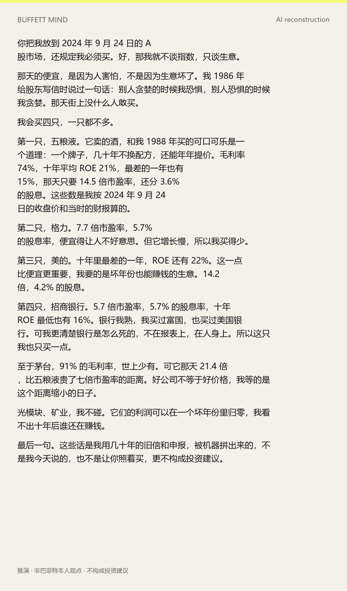
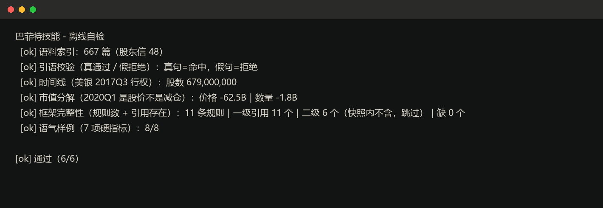

# Buffett Mind

Reconstruct Warren Buffett's decision framework from **what he actually said** and **what Berkshire
actually held** — then answer investment questions with evidence, not quotes.

Most "Buffett skills" give you a methodology. This one gives you a **verifiable data layer**:

- **48 shareholder letters** (1977–2024) with full-text search
- **111 quarters of 13F filings** (1998Q4–2026Q2), 14,060 positions, VWAP cost basis, split-adjusted
- **Quote verification**: every citation is checked against the corpus; fabricated quotes are rejected
- **Reconciliation**: 133 evidence pairs comparing what he said with what he did
- **Tone model**: 11 style rules derived from 18,568 sentences of his own letters





## Quick start

```bash
pip install -r requirements.txt
python scripts/demo.py          # 6 offline checks, no network
python scripts/quote.py --verify "price is what you pay, value is what you get"
python scripts/answer.py --question "Is Apple still worth holding?" --voice
```

## What it can answer

| Question | Command |
|---|---|
| What did he say about gold / banks / airlines / Apple? | `quote.py` / `answer.py` |
| When did he buy, how much, what happened after? | `timeline.py` / `holdings.py` |
| He says he holds forever — how long does he actually hold? | `returns.py` |
| Market value fell 27% — price or selling? | `decompose.py` |
| Is he consistent between words and actions? | `reconcile.py` |
| What would his framework say about this? | `answer.py` (labelled inference) |
| How would his framework score A-shares? | `ashare_fit.py` |

## Why this is different

| | Prompt-only packs | Letter collections | **This repo** |
|---|---|---|---|
| Source letters | excerpts | ✅ full text | ✅ full text + FTS |
| 13F holdings history | ❌ | ❌ | ✅ 111 quarters |
| Cost basis (VWAP, splits) | ❌ | ❌ | ✅ |
| Quote verification | ❌ | ❌ | ✅ rejects fakes |
| Words-vs-actions reconciliation | ❌ | ❌ | ✅ 133 pairs |
| Quantified tone model | ❌ | ❌ | ✅ 18,568 sentences |
| A-share adaptation | ❌ | ❌ | ✅ |
| Runnable offline demo | ❌ | ❌ | ✅ 6/6 checks |

## Three hard rules

1. **Every quote must verify** — `quote.py --verify` or it cannot be used
2. **Market-value changes must be decomposed** — a drop is not a sale
3. **Inference must be labelled** — if he never spoke on it, say so

Rule 1 is not pedantry: the two most-quoted Buffett lines in Chinese — "if you wouldn't hold it ten
years, don't hold it ten minutes" and "be fearful when others are greedy" — are both real (1996 and
1986 letters). Yet his median holding period across 154 decisions is **2 years**, and he did **not**
buy the 2020 crash. Real quotes, misused, are harder to catch than fake ones.

## Data

The repo ships a compact, runnable snapshot (letters index + holdings + a small price window).
Full price history and the third-party Q&A compilation live in the release asset, not in Git.

## Disclaimer

Inference outputs are AI reconstructions, not Buffett's words, and not investment advice.
